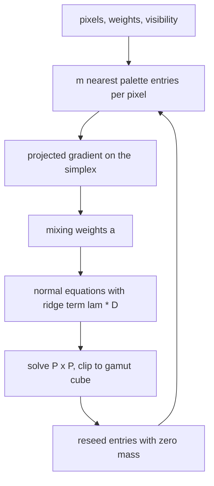
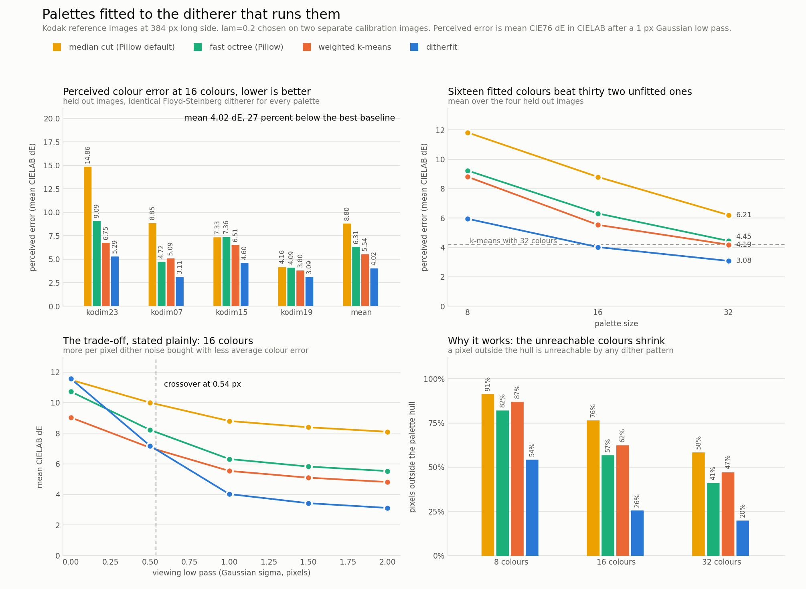
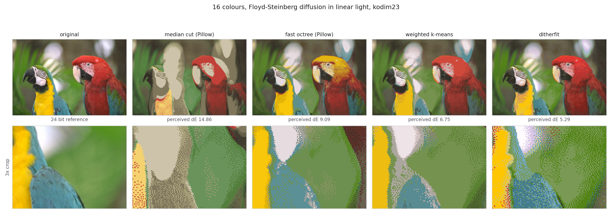

# ditherfit

Colour palettes fitted to the error diffusion that will run them, not to the nearest neighbour assumption every quantizer still makes.

## Problem

Every palette builder in common use (median cut in Pillow and ImageMagick, fast octree, Wu, NeuQuant, plain k-means) minimises the same thing: the distance from each pixel to its single closest palette entry. That objective describes what happens when you quantize with no dithering at all.

Almost nobody ships that. GIF export, e-ink panels, LED matrices, ESP32 displays, retro and pixel art tooling, thermal printers: they all run error diffusion after picking the palette. Error diffusion does not replace a pixel with its closest entry, it reproduces a local average, so the colour a dithered region can actually show is any point inside the convex hull of the palette entries used nearby.

The two objectives disagree in a way that matters. A nearest neighbour optimal palette piles its entries into the dense part of the colour histogram and leaves the saturated corners of the image gamut outside its hull. Those pixels are then unreachable: the diffusion residual has a fixed sign, never cancels, and gets pushed around the image forever. On the Kodak reference images at 16 colours, a weighted k-means palette leaves 62 percent of pixels outside its own hull. The palette is optimal for a renderer nobody uses.

## What this does

`ditherfit` fits the palette to the ditherer. It models each pixel as a convex mixture over the `m` palette entries nearest to it and minimises

```
sum_p  w_p * || c_p - sum_j a_pj q_j ||^2          reproduction error against a reachable mixture
     + lam * w_p * v_p * sum_j a_pj || q_j - c_p ||^2    variance of that mixture, which is the visible dither noise
```

subject to each `a_p` lying in the probability simplex. `w_p` is a per pixel accuracy weight that follows `dL*/dY`, so shadow accuracy is not traded away for highlights. `v_p` is a noise visibility weight from local contrast, near one in flat sky and small in busy texture where granularity is masked.

Both halves of the alternation are exact. The assignment step is a small simplex quadratic program solved by projected gradient, vectorised over all sampled pixels at once. The update step is a single `P x P` linear solve per iteration whose ridge term comes from the noise penalty.

One knob spans two known regimes. At `lam = 0` the fit is pure hull coverage: the palette spreads to span the gamut, average colour is excellent and the texture is grainy. As `lam` grows, mixtures collapse onto single entries and the solution approaches weighted k-means. The useful operating point is in between, and the benchmark picks it on calibration images that are not the ones it reports on.

The package ships the fitter, a Floyd-Steinberg diffuser that works in linear light (physically, light averages linearly, gamma encoded sRGB does not), a CLI, and the measurement harness that produced every number below.

## Why it is interesting

- It changes the objective rather than the search. Thirty years of palette work (median cut, Wu, NeuQuant, k-means variants) has optimised the same nearest neighbour cost function faster or better. The cost function itself is the part that does not match the renderer.
- The failure mode it fixes is invisible to the standard metric. Measured per pixel, a dithered image full of unreachable colours scores fine, because the error is spread into neighbours instead of concentrated. Measured the way a viewer sees it, after the eye integrates over a couple of pixels, the same image is badly off.
- The mechanism is checkable, not a vibe: the fraction of pixels outside the palette's convex hull drops from 62 percent to 26 percent at 16 colours, and that is exactly where the error improvement comes from.
- It costs nothing at render time. The output is an ordinary indexed image with an ordinary palette, so any existing display pipeline consumes it unchanged.

## Architecture

FigJam board: https://www.figma.com/board/TdecLmfmKPHPRIdFchLNVX

The board shows the full data flow: decode to linear light, sample pixels with their two weights, alternate the simplex assignment and the weighted least squares update until the palette converges, then dither in linear light and measure the result in CIELAB through a viewing model.

The inner loop, at code level:



## Results



The metric is mean CIE76 colour difference in CIELAB between the original and the dithered reproduction, with both passed through a 1 pixel Gaussian low pass first. The low pass is the point: error diffusion trades per pixel noise for average accuracy, so scoring the raw pixels scores the dither pattern rather than the colour a viewer sees. Every palette in the comparison is rendered by the same Floyd-Steinberg ditherer in linear light, so the only variable is the palette.

Baseline is weighted k-means, the strongest nearest neighbour palette in the comparison and a stronger baseline than what tools actually ship. At 16 colours, averaged over four held out Kodak images, perceived error falls from 5.54 to 4.02, a 27 percent reduction. Against Pillow's default median cut (8.80) it is 54 percent. A 16 colour ditherfit palette (4.02) is also more accurate than a 32 colour k-means palette (4.19), so the same screen quality fits in half the palette, which on an indexed framebuffer is half the bits per pixel.

`lam = 0.2` was selected by sweeping seven values on two calibration images (kodim05, kodim13) and taking the lowest perceived error. It was then applied unchanged to the four evaluation images, which appear in no part of the fitting procedure.

Sixteen colours, mean over the four held out images:

| palette | perceived dE | raw dE | no dither dE | outside hull |
|---|---|---|---|---|
| median cut (Pillow default) | 8.80 | 11.49 | 6.93 | 76.5% |
| fast octree (Pillow) | 6.31 | 10.72 | 5.97 | 56.8% |
| weighted k-means | 5.54 | 9.02 | 4.99 | 62.4% |
| ditherfit | **4.02** | 11.56 | 6.24 | **25.5%** |

Per image, 16 colours, perceived dE:

| image | median cut | fast octree | k-means | ditherfit |
|---|---|---|---|---|
| kodim23 (parrots) | 14.86 | 9.09 | 6.75 | **5.29** |
| kodim07 (shutters) | 8.85 | 4.72 | 5.09 | **3.11** |
| kodim15 (portrait) | 7.33 | 7.36 | 6.51 | **4.60** |
| kodim19 (lighthouse) | 4.16 | 4.09 | 3.80 | **3.09** |

The trade-off is real and is in the chart rather than hidden. ditherfit carries more raw per pixel error (11.56 against 9.02) because it dithers across wider colour differences, and it is the worse palette if you are not dithering at all (6.24 against 4.99). The crossover is at a 0.54 pixel viewing low pass: integrate over anything wider than half a pixel, which any display at any normal viewing distance does, and the fitted palette wins and keeps widening the gap. If your pipeline does not dither, use k-means; `lam` large recovers it.



Same image, same ditherer, four palettes. Median cut cannot hold the red macaw at all and washes it to beige; fast octree turns its head yellow. ditherfit keeps both birds saturated and the background separation intact. The bottom row is a 3x crop that shows the cost: a visibly busier dither texture, which is the noise term the `lam` knob prices.

## How to run it

```bash
git clone https://github.com/joelvarun/ditherfit
cd ditherfit
python -m pip install -r requirements.txt

# quantize any image with a dither aware palette, and measure it against the baselines
python -m ditherfit path/to/photo.jpg --colors 16 --compare --out photo.16.png

# one image, three palettes, printed numbers (downloads one Kodak image on first run)
python examples/demo_single.py 23 16

# the full benchmark: calibrates lam, scores four held out images, writes docs/results.json
python examples/run_benchmark.py

# redraw the chart and the visual comparison from the saved results
python examples/make_chart.py
python examples/make_panels.py

# sanity tests
python tests/test_core.py
```

The benchmark downloads six images from the Kodak PhotoCD reference set (about 4 MB) into `data/` on first run and caches them; that directory is not committed. The whole run takes about three minutes on a laptop CPU and writes `docs/results.json`, from which both figures are drawn. No number in this repository is typed by hand: the figures read the JSON, the JSON comes from dithering real images.

Useful CLI flags:

| flag | meaning |
|---|---|
| `--colors N` | palette size |
| `--lam L` | dither noise penalty. 0 spans the gamut, large tends to k-means, 0.2 is calibrated |
| `--method` | `ditherfit`, `kmeans`, `mediancut`, `octree` |
| `--no-dither` | nearest neighbour quantization instead of error diffusion |
| `--long-side N` | resize before quantizing |
| `--palette-out p.json` | write the palette as linear RGB, sRGB and hex |
| `--compare` | also build and measure the baseline palettes |

## Example outputs

```
$ python examples/demo_single.py 23 16
kodim23, 16 colours, 384x256 px
palette                perceived dE    raw dE   outside hull   no dither dE
median cut (Pillow)          14.856    17.279         70.8%         10.925
fast octree (Pillow)          9.089    15.571         50.7%          8.726
weighted k-means              6.747    11.492         56.8%          6.801
ditherfit                     5.288    15.337         22.3%          9.242
```

```
$ python -m ditherfit data/kodim23.png --colors 16 --long-side 384 --compare
16 colours, ditherfit palette, lam=0.2
  perceived dE (sigma=1 px) 5.288
  raw dE                    15.337
  pixels outside palette hull 22.3%
  wrote data/kodim23.ditherfit16.png
  mediancut  perceived dE 14.856  raw dE 17.279  outside hull 70.8%
  octree     perceived dE 9.089  raw dE 15.571  outside hull 50.7%
  kmeans     perceived dE 6.747  raw dE 11.492  outside hull 56.8%
```

The calibration sweep, run on two images that are never evaluated, shows the knob doing what the model says it does: `lam` buys per pixel smoothness with average accuracy, and the two meet in the middle.

```
lam=0.0    perceived dE=4.02   raw dE=22.43
lam=0.05   perceived dE=3.76   raw dE=16.13
lam=0.1    perceived dE=3.77   raw dE=14.37
lam=0.2    perceived dE=3.74   raw dE=12.11     <- chosen
lam=0.4    perceived dE=4.77   raw dE=10.66
lam=0.8    perceived dE=5.35   raw dE=10.30
lam=1.6    perceived dE=6.06   raw dE=10.28
```

## Layout

```
ditherfit/
  ditherfit/color.py       sRGB, linear light, CIE XYZ, CIELAB, CIE76
  ditherfit/dither.py      serpentine Floyd-Steinberg in linear light, cube lookup
  ditherfit/palette.py     k-means and Pillow baselines, the ditherfit fit
  ditherfit/metrics.py     perceived error, viewing curve, convex hull check
  ditherfit/images.py      Kodak fetch and cache, pixel sampling and weights
  ditherfit/benchmark.py   calibration and evaluation harness
  ditherfit/cli.py         python -m ditherfit
  examples/                benchmark, chart, panels, single image demo
  tests/test_core.py       colour round trips, simplex projection, regime limits
  docs/                    results.json, before_after.png, panels.png
```

## Limits worth knowing

- The fit runs in linear RGB, where convex mixing is physically correct, with a scalar per pixel weight approximating the CIELAB lightness compression. A full per pixel perceptual metric tensor would be more faithful. The reported error is measured in CIELAB regardless, so the approximation shows up in the result rather than hiding in it.
- Mixtures are restricted to the `m = 4` nearest entries. Error diffusion can in principle reach further, and the restriction is what keeps the assignment step cheap.
- The viewing model is a Gaussian low pass, not a contrast sensitivity function. The chart reports the whole curve from 0 to 2 pixels so the conclusion does not rest on one choice of sigma.
- CIE76 is used rather than CIEDE2000. It is the honest simple choice here: no hue rotation or chroma weighting terms to get subtly wrong, and both palettes are scored by the same ruler.
- Reference images come from the Kodak PhotoCD set, the standard corpus for colour quantization work. They are downloaded at run time and are not redistributed in this repository.
